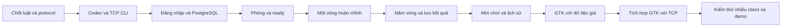

# Pipeline triển khai — The Price Is Right (dự án cá nhân)

Tài liệu nguồn: `Group 11- checkpoint 1.pdf`, 18 trang. Pipeline được lập ngày 16/11/2026.

Mục tiêu: biến nội dung checkpoint 1 thành kế hoạch triển khai và nghiệm thu cho một người phát triển. Đây là dự án cá nhân của bạn; tên nhóm và phân công ba người trong slide là thông tin cũ, không áp dụng. Đã có nền tảng transport/CLI, PostgreSQL/auth/scoring tests và giai đoạn 3 phòng/ready/khán giả; xem [README](README.md), [mốc tuần 1](docs/week_1_status.md) và [nghiệm thu giai đoạn 2](docs/phase_2_status.md), [nghiệm thu phòng](docs/phase_3_status.md). Kế hoạch bên dưới gồm các giai đoạn tuần tự, chưa gán số tuần cho các phần còn lại vì chưa có deadline và quỹ thời gian làm việc của bạn.

## 1. Phạm vi và các quyết định thiết kế

Cập nhật 18/11/2026: đã hoàn tất giai đoạn 5 với transaction lưu kết quả, lịch sử/thống kê và lời mời chơi; xem [nghiệm thu và cách chạy](docs/phase_5_status.md). Bước tiếp theo là giao diện GTK của giai đoạn 6.

### 1.1. Yêu cầu lấy trực tiếp từ slide

| Nội dung | Yêu cầu | Trang |
|---|---|---|
| Nền tảng | Server C/Linux, POSIX TCP, non-blocking, một event loop dùng `select()` | 4, 14 |
| Client | C/Linux, GTK4, giao diện qua GtkBuilder | 4 |
| Lưu trữ | PostgreSQL, truy cập bằng libpq | 4 |
| Tài khoản | Đăng ký, đăng nhập, đăng xuất; server xác thực | 6 |
| Phòng | 2–4 người, tạo/join bằng mã, danh sách thành viên, mời người chơi, rời phòng | 3, 6 |
| Bắt đầu | Chỉ host được start, tất cả người chơi phải ready | 9 |
| Trận | 5 vòng: 3 vòng sản phẩm đơn × 20 giây, 2 vòng giỏ hàng × 30 giây | 7 |
| Dự đoán | Một lần gửi hợp lệ mỗi người mỗi vòng, server kiểm tra deadline và chấm điểm | 7–10 |
| Kết quả | Bảng điểm, xếp hạng, lịch sử trận và thống kê cá nhân | 7–8 |
| Protocol | TCP port 6666, header nhị phân 12 byte, big-endian, payload tối đa 4096 byte | 11 |
| Mở rộng | Quick Match và Ranked nằm ngoài phạm vi bản chính | 3 |

### 1.2. Các quyết định đã chốt

Cập nhật yêu cầu 17/11/2026: thay luật một lần nộp trong slide bằng cho phép sửa giá nhiều lần trước deadline. Server giữ guess hợp lệ cuối cùng và response_ms của lần gửi đó; sửa lỗi/quá hạn không ghi đè giá cũ và không kéo dài vòng.

Ngày 16/11/2026, chủ dự án chấp thuận các đề xuất tại mục này, đồng thời bổ sung: mỗi trận có 2–4 người chơi; người thứ 5 trở đi vào phòng với vai trò khán giả. Đây là phạm vi chính thức, thay thế chính sách cũ từ chối người thứ 5 và chưa hỗ trợ spectator.

| Nội dung | Quyết định |
|---|---|
| Payload | Binary có schema cho từng message; chuỗi UTF-8 có độ dài `u16` đứng trước |
| Tiền | VND nguyên không âm, truyền `u64`, lưu PostgreSQL `BIGINT`; giới hạn nghiệp vụ để mọi giá trị và tổng giỏ nằm trong miền `BIGINT` |
| Giỏ hàng | Mỗi giỏ 2–3 sản phẩm với số lượng; giá thật = tổng `unit_price × quantity` |
| Đồng điểm | Đồng hạng theo tổng điểm, ví dụ 1, 1, 3; nhiều người có thể cùng thắng |
| Bỏ lỡ vòng | Điểm 0; lưu trạng thái không nộp, không giả lập một guess bằng 0 |
| Kết thúc vòng | Đợi hết thời gian kể cả khi mọi người đã nộp, đúng luồng slide trang 8 |
| Khoảng nghỉ | Reveal kết quả 5 giây rồi tự chuyển vòng; thời lượng cấu hình được |
| Vai trò trong phòng | Tối đa 4 PLAYER; người thứ 5 trở đi là SPECTATOR, không bị từ chối chỉ vì đủ 4 người chơi |
| Join khi đang chơi | Được vào làm SPECTATOR; không thay đổi đội hình trận đang diễn ra |
| Thay đổi thành viên | Trong WAITING: thay đổi đội hình PLAYER thì reset ready của người chơi; khán giả vào/rời không ảnh hưởng ready. Host luôn là PLAYER |
| Rời/mất kết nối trong trận | Đánh dấu PLAYER disconnected, giữ kết quả đã có; nếu còn ≥2 PLAYER đang kết nối thì tiếp tục, nếu còn <2 thì ABORTED. Khán giả không tính vào điều kiện này |
| Trận bị hủy | Lưu trạng thái và lý do hủy; không tính vào số trận thắng hoặc điểm trung bình trận hoàn thành |
| Reconnect | Đăng nhập lại có thể vào xem trận với vai trò SPECTATOR; không khôi phục slot PLAYER trong trận đang chạy |
| Lời mời | Mời người đang online và chưa ở phòng; lời mời có hạn 60 giây; chấp nhận bằng JOIN_ROOM kèm mã phòng, luôn kiểm tra lại điều kiện join |
| Quan hệ bạn bè | Bản chính dùng danh sách người chơi online để mời như message catalogue; nếu cần kết bạn/chấp nhận bạn thì bổ sung bảng và message riêng |
| Ảnh | Đóng gói ảnh và manifest trong client; server gửi `image_key`, không truyền ảnh qua payload 4096 byte |
| Bảo mật giá | Bộ asset client chỉ có hình/tên/key, không chứa giá; giá chỉ được gửi sau khi vòng kết thúc |
| Tài khoản online | Mỗi tài khoản một kết nối đăng nhập; đăng nhập lần hai trả `ALREADY_ONLINE` |

Không bổ sung quy tắc “đoán vượt giá thì thua”: slide dùng độ lệch tuyệt đối nên đoán cao và thấp cùng độ lệch được chấm như nhau.

### 1.3. Quy tắc khán giả — mặc định triển khai bổ sung

Yêu cầu khán giả được chủ dự án chốt tại mục 1.2. Các chi tiết vận hành sau là mặc định triển khai bổ sung cho yêu cầu đó:

- Phòng WAITING có slot trống: người mới vào là PLAYER; đủ 4 PLAYER thì người tiếp theo là SPECTATOR. Phòng IN_GAME: mọi người mới vào đều là SPECTATOR, kể cả khi có PLAYER mất kết nối.
- Khán giả xem sản phẩm, countdown, kết quả đã công bố và bảng điểm theo thời gian thực. Không nhận giá thật hoặc guess của người khác trước reveal; không được ready, start hoặc submit guess.
- START_GAME chỉ đếm 2–4 PLAYER và kiểm tra ready của họ, không đợi khán giả. Server kiểm tra role ngay cả khi client tự gửi request bị ẩn trên UI; hành động dành cho PLAYER từ SPECTATOR trả `WRONG_STATE`.
- Không đưa khán giả vào participant list, bảng xếp hạng hay lịch sử/thống kê thi đấu. Họ vẫn xem được bảng điểm của trận đang theo dõi.
- Khi có slot trống trong WAITING, tự chuyển khán giả vào sớm nhất còn kết nối thành PLAYER theo FIFO, cho tới đủ 4 người. Người được chuyển role bắt đầu với ready=false; reset ready đội hình và broadcast ROOM_UPDATE. Không chuyển role giữa trận.
- Khi trận FINISHED hoặc ABORTED trở về WAITING, giữ các PLAYER còn ở phòng, loại người đã rời/mất kết nối rồi mới bổ sung từ hàng đợi khán giả. Nếu host đã rời, chọn PLAYER còn lại vào phòng sớm nhất sau bước bổ sung; không trao quyền host cho người vẫn là SPECTATOR.
- Khán giả rời/mất kết nối chỉ làm giảm số người xem; không hủy trận, không reset ready. Phòng đóng khi không còn bất kỳ thành viên nào.
- Không đặt thêm giới hạn nghiệp vụ cho số khán giả trong kế hoạch này; giới hạn connection/tài nguyên toàn server vẫn áp dụng. ROOM_FULL không được dùng chỉ vì đã đủ 4 PLAYER. Snapshot chỉ chứa danh sách tối đa 4 PLAYER và tổng số khán giả để giữ giới hạn payload.

## 2. Thứ tự triển khai tổng thể



Đường phụ thuộc chính: **protocol → transport → auth → room → round → match → persistence → demo**. Với một người phát triển, ưu tiên kiểm chứng từng tính năng qua CLI trước, sau đó nối GTK vào backend đã chạy được. Mỗi mốc phải có một luồng chạy được từ client tới server rồi trả kết quả.

## 3. Kiến trúc và ranh giới module

```text
GTK UI → client state/controller → shared codec → TCP
                                                ↓
                              select loop / connection buffers
                                                ↓
                                    validate + request router
                                                ↓
                             auth / room / match / scoring
                                      ↓                 ↓
                              libpq repository     event encoder
                                      ↓                 ↓
                                  PostgreSQL       TX queues → clients
```

Server là nơi quyết định thành viên, luật, thời gian, điểm và kết quả. Client hiển thị trạng thái nhận được và gửi hành động. Không tin `user_id`, deadline hay score do client tự khai.

### 3.1. Cấu trúc repository đề xuất

```text
shared/include/       protocol.h, message_codes.h, status_codes.h
shared/src/           codec.c, frame_parser.c
server/src/net/       listener.c, event_loop.c, connection.c
server/src/handlers/  auth_handler.c, room_handler.c, game_handler.c
server/src/game/      room.c, match.c, round.c, scoring.c, timer.c
server/src/db/        db_async.c, user_repo.c, product_repo.c, match_repo.c
client/src/net/       client_connection.c, pending_requests.c
client/src/state/     app_state.c, event_dispatcher.c
client/src/ui/        auth.c, lobby.c, room.c, game.c, results.c, history.c
client/ui/            *.ui
client/assets/        images/, manifest
db/migrations/        schema SQL có thứ tự
db/seeds/             sản phẩm và dữ liệu demo
tests/                unit/, integration/, scenarios/
tools/                cli_client và kịch bản demo
docs/                 protocol.md, game_rules.md, test_plan.md
Makefile
.env.example
README.md
```

`shared/` dùng chung giữa client/server, không phụ thuộc GTK hoặc PostgreSQL. Module game nhận action và thời gian hiện tại, trả kết quả/domain event; không trực tiếp gọi GTK, `send()` hoặc SQL. Transport chịu trách nhiệm biến event thành frame và xếp hàng gửi.

### 3.2. Interface cần thống nhất sớm

- Codec: encode/decode từng message, trả lỗi nếu thiếu/tràn/không hợp lệ.
- Parser: append byte stream, lấy lần lượt các frame hoàn chỉnh, giữ phần byte còn thiếu.
- Router: nhận connection, message đã decode và `request_id`; kiểm tra quyền rồi gọi nghiệp vụ.
- Game: `create_room`, `join_room`, `set_ready`, `start_match`, `submit_guess`, `advance_timers`, `disconnect_player`.
- DB: submit job bất đồng bộ, callback trả kết quả về event loop; callback phải kiểm tra connection/session còn hợp lệ.
- UI: request có callback theo `request_id`; event đi vào app state rồi mới cập nhật widget.

Mỗi client đang chờ một DB job thay đổi trạng thái phải được serialize hoặc đánh dấu pending để các request tiếp theo không vượt qua request trước đó. Dùng generation/session token để kết quả DB cũ không áp vào một socket fd đã được tái sử dụng.

## 4. Chốt protocol trước khi chia việc

### 4.1. Header giữ đúng slide

| Offset | Độ dài | Trường | Quy tắc |
|---|---:|---|---|
| 0 | 2 | magic | `0x5052` |
| 2 | 1 | version | `1` |
| 3 | 1 | kind | request=0, response=1, event=2 |
| 4 | 2 | code | Opcode thống nhất trong shared header |
| 6 | 2 | payload_length | 0–4096 byte |
| 8 | 4 | request_id | Request khác 0; response echo; event bằng 0 |

Không gửi nguyên C struct qua mạng vì padding và endian. Encode từng trường vào buffer. Response bắt đầu bằng `status:u16` (đề xuất), thành công bằng 0; payload thành công/lỗi theo schema tương ứng.

### 4.2. Mã message và dữ liệu tối thiểu đề xuất

Mã số sau là đề xuất mới, chưa có trong slide. Code của response luôn giống request.

| Code | Message | Request / Event payload | Response thành công |
|---|---|---|---|
| `0x0001` | REGISTER | username, password | user_id |
| `0x0002` | LOGIN | username, password | user_id, display_name |
| `0x0003` | LOGOUT | rỗng | rỗng |
| `0x00F0` | PING (chẩn đoán tuần 1) | nonce:u32 | nonce:u32 |
| `0x0101` | CREATE_ROOM | rỗng | room_snapshot |
| `0x0102` | JOIN_ROOM | room_code | room_snapshot |
| `0x0103` | LEAVE_ROOM | rỗng | rỗng |
| `0x0104` | SET_READY | ready:u8 | rỗng |
| `0x0105` | LIST_PLAYERS | cursor, limit | players, next_cursor |
| `0x0106` | INVITE_PLAYER | target_user_id | rỗng |
| `0x0201` | START_GAME | rỗng | match_id |
| `0x0202` | SUBMIT_GUESS | match_id, round_no, amount:u64 | accepted:u8 |
| `0x0301` | GET_HISTORY | cursor, limit | matches, next_cursor |
| `0x0302` | GET_STATS | rỗng, lấy tài khoản hiện tại | stats |
| `0x8101` | ROOM_UPDATE | room_snapshot | — |
| `0x8102` | INVITE_RECEIVED | inviter_id, room_code, expires_in_ms | — |
| `0x8201` | GAME_STARTED | match_id, participant_snapshot, round_count | — |
| `0x8202` | NEW_ROUND | match_id, round_no, type, items, duration_ms, remaining_ms | — |
| `0x8203` | ROUND_RESULT | match_id, round_no, actual_total, guesses, scores, totals | — |
| `0x8204` | GAME_OVER | match_id, outcome, rankings, abort_reason | — |
| `0x8205` | GAME_SNAPSHOT | match_id, match_state, participant_snapshot, round_no, round_state, items, remaining_ms, public_scores, revealed_result nếu có | — |

`room_snapshot`: room_code, room_state, host_id, revision, self_role (`PLAYER=0`, `SPECTATOR=1`), spectator_count:u32, danh sách tối đa 4 PLAYER gồm user_id/name/ready/connected. ROOM_UPDATE được encode theo người nhận vì self_role khác nhau. `NEW_ROUND.items` gồm product_id/name/image_key/quantity, tuyệt đối không có giá thật. `GAME_OVER.outcome` phân biệt FINISHED và ABORTED; rankings khi hủy chỉ mang tính thông tin.

JOIN_ROOM thành công trong IN_GAME: queue response chứa room_snapshot, tiếp theo GAME_SNAPSHOT cho người mới vào, rồi các event phát sinh sau đó theo đúng thứ tự. Chụp snapshot và gắn người xem vào nhóm broadcast trong cùng lượt xử lý event loop để không bỏ lỡ chuyển vòng. Snapshot chỉ chứa trạng thái công khai của vòng hiện tại, tổng điểm đã công bố và kết quả vòng hiện tại nếu đã REVEALED; không gửi toàn bộ lịch sử vòng hoặc giá/guess chưa reveal. Trong PREPARING có thể chưa có items; khi đang lưu kết quả chỉ gửi điểm đã reveal, chờ GAME_OVER xác nhận outcome. Khi quay về WAITING, ROOM_UPDATE thông báo role sau khi bổ sung PLAYER theo FIFO.

Đề xuất ID `u64`, số vòng `u8`, thời lượng `u32`, revision `u32`, list_count `u16`, enum `u8`; chuỗi `u16 length + bytes`. Độ dài tính theo byte UTF-8. Giới hạn username 32 byte, password 128 byte, tên hiển thị/sản phẩm 96 byte, image_key 64 byte; kiểm tra độ dài trước copy/cấp phát. Không log password.

History và player list phải phân trang, đề xuất limit mặc định 10 và tối đa 20, đồng thời encoder phải dừng trước giới hạn 4096 byte và trả cursor tiếp theo; không được cắt ngang một record. Lịch sử MVP trả tóm tắt trận; xem chi tiết từng vòng cần message bổ sung nếu bạn muốn làm.

### 4.3. Quy tắc xử lý lỗi và thứ tự

1. Header sai, version/kind không hợp lệ hoặc payload dài hơn 4096: đóng kết nối.
2. Frame request hợp lệ nhưng code/payload/nghiệp vụ sai: trả error với cùng code/request_id; không đổi trạng thái game.
3. Request của client có request_id=0: coi là sai quy tắc framing và đóng kết nối theo đặc tả đã chốt.
4. Hành động được chấp nhận: xếp response vào queue của người gửi trước, sau đó xếp các event phát sinh. TCP giữ thứ tự byte trên từng kết nối.
5. `SUBMIT_GUESS` hợp lệ trong cùng vòng ACCEPTING cập nhật giá và response_ms; lần hợp lệ cuối cùng được chấm điểm. Request sai/quá hạn không ghi đè lần trước. Không tự retry mutation khi chưa biết kết quả vì lần gửi lại cũng cập nhật thời gian.
6. Với match_id/round_no không khớp, trả `WRONG_STATE`; nếu đúng vòng đã đóng do hết giờ, trả `ROUND_EXPIRED`. Ghi rõ thứ tự kiểm tra trong `protocol.md`.
7. Gán số cố định cho toàn bộ status trên slide, không dùng string làm wire enum; thêm status mới chỉ khi có schema và test.

## 5. Pipeline runtime

### 5.1. Server event loop

```text
Khởi động → đọc config → connect DB async → kiểm tra migration
           → nạp product catalogue → mở listening socket → phục vụ

Mỗi iteration:
  1. Dựng lại readfds/writefds và timeout tới deadline gần nhất.
  2. select(max_fd + 1, ...).
  3. Lấy monotonic time; advance các timer đã tới hạn trước xử lý guess.
  4. Accept các kết nối mới tới EAGAIN, trong giới hạn mỗi iteration.
  5. Đọc các socket sẵn sàng, append RX buffer.
  6. Parse các frame hoàn chỉnh, timestamp, validate, dispatch.
  7. Tiến hành DB I/O/callback cho descriptor sẵn sàng.
  8. Gửi bớt TX queue khi writable; giữ offset nếu partial send.
  9. Kiểm tra timer lại, dọn connection và room rỗng.
```

Chi tiết bắt buộc: `recv()` có thể trả một phần header, nhiều frame hoặc 0 khi peer đóng; `send()` có thể gửi thiếu. Xử lý `EINTR`, `EAGAIN/EWOULDBLOCK` và lỗi kết nối. Chỉ theo dõi writable khi có dữ liệu chờ gửi. Không để `SIGPIPE` kết thúc server.

Mỗi connection có fd, generation, auth state, user_id, room reference, RX buffer, TX queue/offset, thời điểm hoạt động và pending DB request. Đặt giới hạn tổng RX/TX queue và số frame xử lý mỗi lượt; ngắt client quá chậm khi vượt ngưỡng. Kiểm tra `fd < FD_SETSIZE` trước đưa vào fd_set. `select()` sửa fd sets và có thể sửa timeout, vì vậy dựng lại mỗi vòng. Các quy tắc này dựa trên [Linux select(2)](https://man7.org/linux/man-pages/man2/select.2.html).

### 5.2. Auth → room → match

1. REGISTER: kiểm tra dữ liệu → hash mật khẩu bằng thư viện đã kiểm chứng với salt riêng → insert user; unique constraint chống trùng username.
2. LOGIN: lấy password hash → verify → kiểm tra online → gắn user vào connection → response. Việc băm/verify có chi phí phải được đo; nếu làm nghẽn event loop, đưa riêng công việc này sang worker, trong khi network/game state vẫn do một event loop quản lý.
3. CREATE_ROOM: tạo code khó đoán và kiểm tra collision → host được thêm vào room WAITING → trả snapshot.
4. JOIN_ROOM: đã auth, chưa ở phòng khác, room tồn tại → WAITING và còn slot thì gán PLAYER, nếu không thì gán SPECTATOR. Chỉ reset ready nếu đội hình PLAYER đổi → response và ROOM_UPDATE; nếu IN_GAME gửi thêm GAME_SNAPSHOT cho người mới vào.
5. SET_READY: chỉ PLAYER trong WAITING được cập nhật ready → broadcast snapshot. Host cũng phải ready; SPECTATOR không có trạng thái ready.
6. START_GAME: kiểm tra người gửi là host, có 2–4 PLAYER và tất cả PLAYER ready → khóa participant list, không gồm SPECTATOR → chuyển room IN_GAME, match PREPARING.
7. Tạo match record và chụp dữ liệu sản phẩm cần dùng; chỉ bắt đầu gameplay sau khi phần chuẩn bị DB thành công. Không query sản phẩm trong hot path nhận guess.
8. Broadcast GAME_STARTED cho cả PLAYER/SPECTATOR → bắt đầu vòng 1. Sau 5 vòng, lưu kết quả → GAME_OVER cho cả phòng → room WAITING, bổ sung PLAYER từ hàng đợi khán giả, chọn lại host nếu cần và reset ready.

LOGOUT/rời kết nối phải đi qua cùng logic cleanup thành viên, không chỉ xóa auth flag. Không tự động gửi event tới phiên đăng nhập khác của người đã rời; họ phải JOIN_ROOM lại và chỉ được xem với role SPECTATOR nếu trận đang chạy. Khán giả không thay thế một PLAYER disconnected trong trận.

### 5.3. Một vòng chơi

```text
PREPARING → thiết lập sản phẩm, start/deadline → ACCEPTING
ACCEPTING → nhận/cập nhật guess mỗi người tới deadline → REVEALED
REVEALED → công bố giá/điểm → nghỉ 5 giây → vòng tiếp theo
```

- Dùng `CLOCK_MONOTONIC` cho start/deadline và response time; dùng thời gian UTC riêng cho record lịch sử.
- Server tính T khi nhận và parse được đầy đủ request hợp lệ; không dùng timestamp do client gửi. Chấp nhận khi `receive_time < deadline` và vòng còn ACCEPTING.
- Định nghĩa này bao gồm độ trễ truyền mạng; dữ liệu còn nằm trong kernel buffer khi server chưa đọc xong không được coi là đã nhận đúng hạn.
- Client hiển thị countdown dựa trên remaining_ms nhận được và monotonic clock cục bộ. Countdown chỉ hỗ trợ hiển thị; client có thể nhận ROUND_EXPIRED dù đồng hồ UI còn một ít thời gian vì độ trễ.
- Server không gửi một event mỗi giây. Khi tới deadline, chuyển state trước rồi chấm, đảm bảo chỉ reveal một lần.
- Nếu một người đã nộp rồi mới disconnect, giữ guess đó; các vòng sau không nộp thì 0 điểm.

### 5.4. Công thức chấm điểm đúng slide trang 10

```text
A = max(0, 1 - abs(G - P) / P)
Score = round(1000 × A × (0.9 + 0.1 × (1 - T / T_max)))
```

`P > 0`; phép chia là số thực. T và T_max phải cùng đơn vị. Chỉ chấm guess hợp lệ trước deadline; clamp T trong [0, T_max] để bảo vệ tính toán. Chuyển sang kiểu số phù hợp trước khi trừ để tránh unsigned underflow. Quy ước round half-up cho giá trị không âm và dùng cùng một implementation phía server.

Ví dụ slide: P=500.000, G=490.000, T_max=20 giây → T=5 giây được 956 điểm; T=10 giây được 931 điểm. Mỗi vòng tối đa 1000 điểm, trận tối đa 5000. Không gửi/không hợp lệ không được cộng điểm. Test phải khóa đúng hai ví dụ này.

### 5.5. Database không chặn timer

Mục tiêu cuối: đưa socket của libpq vào `select()`; dùng kết nối non-blocking, `PQsendQueryParams`, `PQflush`, `PQconsumeInput`, `PQisBusy`, và đọc `PQgetResult` cho tới NULL. Theo dõi writable khi PQflush còn dữ liệu; mỗi connection DB xử lý tuần tự job, không gửi query mới trước khi query cũ đã drain hết. Nguồn: [libpq asynchronous command processing](https://www.postgresql.org/docs/16/libpq-async.html).

Ở milestone auth đầu tiên có thể dùng truy vấn đồng bộ để kiểm tra luồng, nhưng phải thay trước nghiệm thu gameplay nhiều phòng. Việc dùng socket client non-blocking không tự làm truy vấn DB thành non-blocking. Timeout DB và cancellation là một phần của adapter.

Lưu kết quả cuối bằng transaction: rounds/items/submissions/match_players → cập nhật match FINISHED → COMMIT. Thêm unique key để retry không sinh bản ghi trùng. Chỉ phát GAME_OVER FINISHED sau commit; nếu DB lỗi, giữ kết quả trong bộ nhớ ở pha hoàn tất đang chờ lưu, retry có giới hạn. Hết giới hạn thì thông báo lỗi rõ, không giả báo đã lưu; sản phẩm MVP không cam kết khôi phục dữ liệu chưa commit sau khi process crash.

## 6. Thiết kế dữ liệu

| Bảng | Cột chính/ý nghĩa |
|---|---|
| users | id, username UNIQUE, display_name, password_hash, created_at |
| products | id, name, image_key, price_vnd CHECK > 0, active |
| matches | id, room_code_snapshot, status, started_at, ended_at, abort_reason |
| match_players | match_id, user_id, display_name_snapshot, total_score, rank, disconnected; UNIQUE(match_id,user_id) |
| rounds | id, match_id, round_no, round_type, duration_ms, actual_total_vnd; UNIQUE(match_id,round_no) |
| round_items | round_id, item_no, product_id, product_name_snapshot, unit_price_vnd_snapshot, quantity; UNIQUE(round_id,item_no) |
| submissions | round_id, user_id, guessed_price_vnd nullable, response_ms nullable, score, submission_status; UNIQUE(round_id,user_id) |

Phòng đang chờ, ready, session, lời mời và hàng đợi khán giả lưu trong RAM. Thành viên phòng có role và thứ tự vào phòng để bổ sung PLAYER theo FIFO. Đội hình trận được giữ riêng với danh sách thành viên hiện tại của phòng. Chỉ PLAYER tham gia trận được ghi vào match_players/submissions; khán giả không có record thi đấu. Dữ liệu giá/tên trong trận dùng snapshot để lịch sử không thay đổi khi sửa catalogue.

GET_HISTORY chỉ trả trận của tài khoản đang xác thực. GET_STATS tổng hợp từ trận FINISHED: số trận, số lần đồng hạng nhất, win rate, điểm trung bình và điểm cao nhất. Ưu tiên query từ dữ liệu gốc; chưa cần bảng cache thống kê để tránh cập nhật lệch.

Thêm foreign keys và index cho lịch sử theo user/match. Tất cả SQL có dữ liệu người dùng dùng parameter binding. Thông tin DB lấy từ biến môi trường, không commit mật khẩu. Dataset demo đề xuất 30 sản phẩm; chuẩn bị ảnh hợp lệ và giá cố định để demo có thể lặp lại.

## 7. Pipeline client GTK4

Các màn hình: Auth → Lobby → Room → Game → Round Result → Final Result; History/Stats mở từ Lobby.

1. Tạo GtkBuilder UI với dữ liệu giả theo schema đã chốt; thống nhất app state độc lập với widget.
2. Kết nối TCP non-blocking và theo dõi fd qua GLib main loop; không `recv()` blocking trong callback của nút bấm.
3. Dùng chung codec; response được ghép với pending request qua request_id, event đi qua event dispatcher.
4. Khi bấm submit, chuyển sang pending để tránh double-click; chỉ xác nhận “đã nộp” khi server trả OK. Bị từ chối thì hiển thị nguyên nhân và bật lại nếu vẫn được phép.
5. ROUND_RESULT hiển thị giá thật, guess của từng người, điểm vòng và tổng điểm. GAME_OVER kết thúc countdown và hiển thị outcome.
6. Khi mất kết nối, hủy timer và pending request, xóa state trận cục bộ, đưa về luồng đăng nhập với thông báo.
7. Ảnh không tồn tại dùng placeholder; pre-load ảnh trước trận để giảm giật UI.
8. Room hiển thị tối đa 4 slot PLAYER và số khán giả. Role SPECTATOR có nhãn “Đang xem”, không có nút ready/start/submit; màn hình game chỉ hiển thị sản phẩm/countdown/kết quả. Khi nhận GAME_SNAPSHOT, khởi tạo ngay trạng thái vòng đang xem; khi ROOM_UPDATE đổi self_role sang PLAYER, hiển thị điều khiển chơi và yêu cầu ready lại.

Tất cả cập nhật GTK phải ở main thread. Nếu dùng worker cho công việc khác, chuyển kết quả về main context; xem [GTK threading](https://docs.gtk.org/gtk4/section-threading.html). Với socket non-blocking vẫn phải xử lý WOULD_BLOCK sau tín hiệu readiness: [Gio.Socket](https://docs.gtk.org/gio/class.Socket.html).

## 8. Các giai đoạn triển khai cá nhân và tiêu chí hoàn thành

Thực hiện theo thứ tự dưới đây. Mỗi giai đoạn có thể kéo dài nhiều phiên làm việc; chưa quy đổi thành tuần khi chưa biết quỹ thời gian. Đạt tiêu chí của giai đoạn trước rồi mới mở rộng sang giai đoạn sau.

### Giai đoạn 1 — Đặc tả, môi trường và TCP

1. Viết `protocol.md` và `game_rules.md` theo các quyết định đã chốt; cố định opcode/status/schema.
2. Tạo repository, Makefile và môi trường Linux; smoke-check build GTK4/libpq sớm để phát hiện lỗi môi trường.
3. Viết shared codec/parser, TCP listener/select, per-client RX/TX và CLI test client.
- Qua mốc khi: 4 CLI client kết nối được; frame chia/ghép parse đúng; partial send không mất byte; header sai chỉ đóng connection tương ứng.

### Giai đoạn 2 — Database và tài khoản

Trạng thái: đã triển khai và kiểm thử trên macOS; [kết quả chi tiết](docs/phase_2_status.md). Linux/ASan vẫn cần kiểm chứng ở môi trường phù hợp.

1. Viết migration, seed sản phẩm và hàm scoring độc lập với test đúng ví dụ slide.
2. Tạo DB adapter/repository, REGISTER/LOGIN/LOGOUT, request routing, auth guard và cleanup session.
3. Kiểm tra luồng qua CLI; chuyển DB I/O sang async trước khi nghiệm thu gameplay đồng thời.
- Qua mốc khi: đăng ký/đăng nhập được, dữ liệu còn sau restart; trùng username/sai mật khẩu/login hai nơi trả đúng lỗi; callback DB không tác động lên fd đã tái sử dụng.

### Giai đoạn 3 — Phòng, ready và vai trò

Trạng thái: đã triển khai CREATE/JOIN/LEAVE, role/FIFO, ready, chuyển host và ROOM_UPDATE qua CLI; [nghiệm thu](docs/phase_3_status.md). START_GAME đã nối vào engine giai đoạn 4.

1. Viết CREATE/JOIN/LEAVE, mã phòng, host, ready, PLAYER/SPECTATOR và hàng đợi FIFO.
2. Nối ROOM_UPDATE với CLI; kiểm tra quyền start và các trường hợp rời/mất kết nối.
- Qua mốc khi: có 2–4 PLAYER; người thứ 5 trở đi là SPECTATOR; người xem vào/rời không reset ready; host chuyển đúng và bổ sung slot chỉ khi WAITING.

### Giai đoạn 4 — Một vòng rồi đủ năm vòng

Trạng thái: đã có engine và CLI chơi đủ 5 vòng, timer/scoring/snapshot/abort; [nghiệm thu giai đoạn 4](docs/phase_4_status.md). Persistence được bổ sung ở giai đoạn 5.

1. Viết state machine match/round, tích hợp monotonic timer vào select, lựa chọn sản phẩm và kiểm tra guess.
2. Hoàn thành một vòng qua CLI: start → submit → timeout → scoring → reveal.
3. Mở rộng thành 3 vòng đơn × 20 giây + 2 vòng giỏ × 30 giây, reveal 5 giây, đồng hạng và abort.
4. Thêm GAME_SNAPSHOT cho khán giả vào giữa trận; broadcast dữ liệu công khai cho cả hai role.
- Qua mốc khi: chơi đủ 5 vòng qua CLI; sửa giá trong hạn được nhận, sửa trễ bị từ chối và giữ giá cũ; điểm đúng; khán giả không can thiệp trận; DB chậm không làm đứng timer phòng khác.

### Giai đoạn 5 — Lưu kết quả và các tính năng phụ trợ

Trạng thái: đã triển khai và kiểm thử; [nghiệm thu giai đoạn 5](docs/phase_5_status.md). Schema v2 ghi nguyên tử 5 bảng, retry có giới hạn và idempotency; GAME_OVER chỉ phát sau commit. History phân trang bằng history_seq giảm dần, stats chỉ tính FINISHED. Online list/lời mời có hạn và CLI đã hoạt động. Hàng đợi ghi chưa bền vững qua crash trước commit.

1. Viết transaction lưu trận, snapshot sản phẩm và xử lý retry không tạo kết quả trùng.
2. Hoàn thiện GET_HISTORY/GET_STATS, LIST_PLAYERS/INVITE_PLAYER và thời hạn lời mời.
3. Chạy nhiều phòng, kiểm tra disconnect, queue limits và phân quyền dữ liệu.
- Qua mốc khi: ít nhất 2 phòng chơi đồng thời; lịch sử đúng sau restart; khán giả không có record thi đấu; lời mời và phân trang hoạt động qua CLI.

### Giai đoạn 6 — Giao diện GTK và tích hợp

Kế hoạch chi tiết theo màn hình, kiến trúc client, 10 mốc triển khai và ma trận nghiệm thu: [UI_PIPELINE.md](docs/UI_PIPELINE.md). Đây là kế hoạch, chưa phải trạng thái đã triển khai GTK.

1. Tạo GtkBuilder Auth/Lobby/Room, client connection và pending requests dùng codec chung; nối auth/phòng trước.
2. Thêm Game/Round Result/Final Result, ảnh và countdown, trạng thái pending/accepted.
3. Thêm chế độ khán giả, khởi tạo từ GAME_SNAPSHOT và cập nhật role từ ROOM_UPDATE.
4. Nối UI mời người online, history/stats, placeholder ảnh và thông báo mất kết nối.
- Qua mốc khi: toàn bộ tính năng chính có luồng UI chạy được; UI không treo; không lộ giá trước reveal; khán giả không có điều khiển dành cho PLAYER.

### Giai đoạn 7 — Ổn định và bàn giao

1. Chạy ma trận test, sanitizer và bài test nhiều client; sửa các lỗi còn lại.
2. Build trên Linux sạch, viết README, seed/reset DB, kịch bản demo và báo cáo.
- Qua mốc khi: người khác làm theo README có thể khởi động DB/server/client, chơi 4 người đủ 5 vòng cùng khán giả và xem lịch sử.

Nếu cần rút gọn thời gian: bỏ animation/trang trí, dùng màn hình phụ đơn giản và hoãn Quick Match/Ranked; giữ toàn bộ yêu cầu đã chốt về protocol, gameplay, khán giả và persistence.

## 9. Tổ chức công việc cho một người

Bạn phụ trách toàn bộ server, client, game logic và database. Phân chia theo module để dễ quản lý mã, không chia theo thành viên trong slide.

- Chỉ tập trung một tính năng từ đầu tới cuối tại một thời điểm: codec → handler/nghiệp vụ → DB nếu cần → CLI kiểm chứng → UI khi đến giai đoạn GTK.
- Dùng chung codec trong `shared/`; thay đổi schema phải cập nhật shared header, tài liệu và test vectors trong cùng thay đổi.
- Mỗi task ghi dependency, đầu ra và tiêu chí đạt. Cuối phiên ghi ngắn phần đã xong, lỗi đang gặp và bước tiếp theo.
- Giữ mỗi mốc có một bản chạy được; commit theo tính năng sau khi build và kiểm tra liên quan đã qua. Không cần quy trình phân công/reviewer bắt buộc cho dự án cá nhân.
- Dùng CLI và các tài khoản demo để tự kiểm thử nhiều người chơi/khán giả; một người phát triển vẫn kiểm chứng được game multiplayer.

## 10. Kiểm thử cần có

| Nhóm | Tình huống | Kỳ vọng |
|---|---|---|
| Framing | Header gửi từng byte; payload chia nhiều lần | Chỉ dispatch sau khi đủ frame |
| Framing | Nhiều frame trong một recv | Parse hết trong budget, không mất byte |
| Framing | Magic sai, version sai, length=4097 | Đóng đúng connection, server còn chạy |
| Payload | Truncated string, count quá lớn, trailing byte sai schema | Không đọc vượt buffer; trả lỗi cho frame request hợp lệ |
| Send | Client đọc chậm, send chỉ gửi một phần | Giữ offset, không làm hỏng frame hoặc tăng queue vô hạn |
| Auth | Trùng username, sai password, login hai nơi | Mã lỗi đúng, không thay đổi auth sai |
| Room | Người thứ 5 và tiếp theo vào phòng | JOIN thành công, role SPECTATOR, số PLAYER vẫn tối đa 4 |
| Room | Code không tồn tại | ROOM_NOT_FOUND, không thêm thành viên |
| Spectator | Join IN_GAME, kể cả khi có PLAYER disconnected | Role SPECTATOR, nhận snapshot công khai đúng thứ tự, không thay đổi đội hình trận |
| Spectator | Ready/start/submit từ client sửa đổi | WRONG_STATE, không thay đổi game hoặc lưu submission |
| Spectator | Vào/rời khi PLAYER đã ready | Không reset ready; start chỉ kiểm tra PLAYER |
| Spectator | Có slot trống ở WAITING hoặc sau khi trận kết thúc | Bổ sung theo FIFO, role mới PLAYER, reset ready và chọn lại host nếu cần |
| Spectator | Có 1 PLAYER và nhiều người xem giữa trận | ABORTED; khán giả không giữ trận đủ điều kiện tiếp tục |
| Spectator | Khán giả cũ đăng nhập lại hoặc rời phòng | Không tự nhận lại quyền PLAYER; không tăng số trận/điểm/thống kê |
| Quyền | Non-host start, thiếu ready | Từ chối, không tạo trận |
| Guess | Round sai, giá ngoài giới hạn, nộp lần hai | Không ghi đè guess hợp lệ |
| Deadline | Ngay trước, đúng tại và sau deadline | Chỉ trước deadline được chấp nhận |
| Scoring | Hai ví dụ slide, G=P, lệch ≥P, không nộp | Điểm đúng, 0–1000 mỗi vòng |
| Game | Đủ 5 vòng và có hòa điểm | Đúng loại vòng/thời lượng, rank theo chính sách |
| Disconnect | Host rời lobby, PLAYER rời trận, SPECTATOR rời trận | Chuyển host/bổ sung FIFO trong WAITING; hủy khi còn <2 PLAYER đang kết nối; khán giả rời không ảnh hưởng trận |
| Cleanup | Disconnect khi query pending rồi fd được tái sử dụng | Callback cũ không đăng nhập/gửi dữ liệu cho client mới |
| DB | Lỗi giữa transaction hoặc retry commit chưa rõ kết quả | Không lưu nửa trận, không sinh kết quả trùng |
| DB chậm | Delay query lúc phòng khác đang ACCEPTING | Timer và I/O phòng khác vẫn hoạt động |
| History | Đổi giá sản phẩm sau khi chơi | Kết quả cũ giữ giá snapshot |
| Privacy | GET_HISTORY, NEW_ROUND và GAME_SNAPSHOT | Không lộ lịch sử người khác, giá thật hoặc guess trước reveal, kể cả cho SPECTATOR |
| GTK | Spam nút, response lỗi, thiếu ảnh, mất mạng | UI không treo, state hiển thị nhất quán |
| Đồng thời | Đề xuất 10 phòng × 4 CLI clients | Không lẫn event/điểm giữa phòng; đo CPU, bộ nhớ và timer delay |

Test logic dùng clock giả để kiểm tra deadline chính xác, không phải chờ 20–30 giây. Integration test ít nhất một trận dùng thời lượng thật. Build C với warnings nghiêm ngặt; dùng AddressSanitizer/UndefinedBehaviorSanitizer trong bản debug và chạy test lỗi mạng. Mức tải 40 client là mục tiêu kiểm chứng đề xuất, không phải năng lực đã được đo.

## 11. Build, vận hành và demo

Môi trường đích là Linux đúng slide; máy hiện tại là macOS nên bạn cần Linux VM/máy Linux làm môi trường tích hợp. PostgreSQL có thể chạy trong container; GUI GTK chạy trong Linux desktop hoặc môi trường có display phù hợp. Ghi phiên bản toolchain và thư viện đã kiểm chứng vào README.

Các mục củng cố 1–4 (17/11/2026) đã hoàn thiện: demo tự động, client core, cleanup/lỗi kết nối và structured log; xem [nghiệm thu](docs/foundation_improvements.md). Có `make demo` và `make demo-spectator`; đây là công cụ kiểm tra lobby, chưa phải gameplay.

Makefile hiện có các target `server`, `cli`, `run-server`, `unit`, `integration`, `auth-test`, `room-test`, `test`, `debug`, `ubsan`, `check-deps`, `smoke-deps`, `db-start/stop/status/migrate/seed`. Server link libpq và libsodium; auth dùng Argon2id ở một password worker riêng, network/session vẫn do một event loop quản lý. `client` GTK sẽ được thêm ở giai đoạn giao diện. Xem [protocol v1](docs/protocol.md) để biết opcode/status và ranh giới handler hiện tại.

CI khi push hoặc mở PR nếu có: build shared/server/client trên Linux → unit tests codec/scoring/state → integration với PostgreSQL → lưu log khi lỗi. Chỉ thêm bước build/test cho module đã tồn tại ở giai đoạn hiện tại. Một release demo cần source, migration/seed, asset manifest, config mẫu và hướng dẫn khởi động. Logging có connection generation, user_id, room_code, match_id, round_no, request_id; không ghi password hay giá bí mật vào client log.

Kịch bản demo đề xuất:

1. Khởi động PostgreSQL và server, mở 4 client, đăng nhập.
2. Host tạo phòng, mời một người và cho các người còn lại join bằng mã.
   Mở thêm client thứ 5 vào cùng phòng để trình diễn role SPECTATOR và giao diện chỉ xem; thử thêm một khán giả vào giữa trận để kiểm chứng snapshot.
3. Thử start khi chưa ready để trình diễn kiểm tra quyền/trạng thái; sau đó ready và start.
4. Chơi 3 vòng đơn, 2 vòng giỏ; có một lần nộp lặp và một người không nộp.
5. Hiển thị ranking, quay lại phòng, mở history/stats.
6. Demo riêng mất kết nối/hủy trận và nhiều phòng, tránh phá ngang trận chính.

## 12. Việc bắt đầu ngay

Các bước 1–4 dưới đây đã hoàn thành ở giai đoạn 1–3. Gameplay có timer phía server đã hoàn thành ở giai đoạn 4; persistence/history/stats và lời mời đã hoàn thành ở giai đoạn 5. Tiếp theo là GTK ở giai đoạn 6.

1. Đưa mục 1.2 đã chốt và mặc định khán giả tại mục 1.3 vào `docs/game_rules.md`; viết opcode, status, schema payload và deadline trong `docs/protocol.md`.
2. Chuẩn bị Linux, Makefile, smoke-check GTK4/libpq; tạo shared codec + server nhận/gửi frame + CLI, kiểm tra fragmentation/coalescing.
3. Viết migration/seed, scoring tests và auth; kiểm chứng đăng nhập qua CLI.
4. Viết room state machine với PLAYER/SPECTATOR, ready và ROOM_UPDATE. Mốc tích hợp đầu tiên của auth/phòng là hai CLI client đăng nhập, cùng vào phòng và nhận cùng trạng thái.
5. Tiếp tục gameplay và lưu trận qua CLI theo mục 8; sau đó nối GTK lần lượt vào các luồng đã chạy được.

Definition of Done cho dự án: toàn bộ tính năng bắt buộc ở mục 1.1–1.2 chạy qua UI, trận 2–4 PLAYER đủ 5 vòng, người thứ 5 trở đi vào xem được với role SPECTATOR kể cả giữa trận, phân quyền và bổ sung slot đúng mục 1.3, protocol chịu được TCP fragmentation/partial send, deadline do server kiểm soát, điểm/lịch sử chỉ tính PLAYER, xử lý disconnect theo policy và demo được trên Linux theo README.
