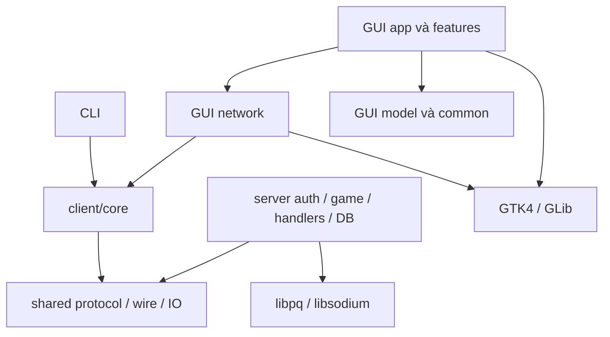

# Cấu trúc package và cách phát triển

Dự án dùng C, nên package ở đây là các module source/header theo trách nhiệm, được ghép vào binary bằng Makefile. Ba package chính là shared, server và client. Mỗi package có module.mk khai báo source và header của mình; Makefile gốc giữ các target build/test/chạy ứng dụng.

## 1. Bản đồ source

```text
shared/
  include/                  API protocol, codec, TX queue, room/game/account wire
  src/                      Code dùng chung, không phụ thuộc GTK hoặc PostgreSQL
  module.mk

server/
  include/                  API và context nội bộ server
  src/main.c                Khởi động, event loop và vòng đời connection
  src/log.c                 Structured log
  src/auth/                 Tài khoản, validation, password worker
  src/db/                   libpq async, serialize và lưu kết quả
  src/game/                 Phòng, match, timer và scoring
  src/handlers/             Request phòng và tài khoản/social
  module.mk

client/
  include/pr_client.h       API TCP và command dùng chung cho CLI/GTK
  include/pr_ui_state.h     State dữ liệu GUI, không chứa widget GTK
  include/pr_ui.h           Header tổng hợp để code cũ tiếp tục build
  include/ui/
    types.h                 pr_app: state, widget references và timer IDs
    app.h                   Khởi tạo, hủy, điều hướng, notification
    network.h               Kết nối, adapter GLib và dispatch response/event
    auth.h                  Đăng ký, đăng nhập và màn hình auth
    lobby.h                 Sảnh, đăng xuất, tạo/vào phòng
    room.h                  Ready, start, leave, host và phòng chờ
    gameplay.h              Countdown, gửi/cập nhật giá và màn chơi
    results.h               Kết quả vòng/trận, quay về phòng/sảnh
    account.h               Lịch sử và thống kê
    social.h                Người online và lời mời
    common.h                Hiển thị tên người chơi và ảnh sản phẩm
  src/core/
    connection.c            TCP nonblocking, parser, pending, deadline
    commands.c              Encode request từ thao tác client
  src/gui/
    main.c                  Entry point GtkApplication
    app.c                   Dựng cửa sổ/stack, CSS, điều hướng, lifecycle
    model/state.c           Khởi tạo/reset state, mock, định dạng tiền và status
    network/
      net_source.c          Đưa fd/deadline vào GLib main loop
      controller.c          Connect/disconnect/PING và connection badge
      events.c              Decode response/event, cập nhật state, gọi render
    common/presentation.c   Tên người chơi, ánh xạ image_key và placeholder
    features/
      auth/auth.c
      lobby/lobby.c
      room/room.c
      gameplay/gameplay.c
      results/results.c
      account/account.c
      social/social.c
  resources/                CSS, ảnh và manifest GResource
  module.mk

tools/                      CLI, demo bots, DB helpers và dependency smoke
db/                         Migration và seed
tests/unit/                 Kiểm tra protocol, domain, core và state/UI helpers
tests/integration/          Server/CLI/PostgreSQL và GUI startup smoke
```

app.c trước đây chứa khoảng 2.800 dòng; nay chỉ còn phần dựng cửa sổ và điều hướng. Các hành động, callbacks GTK và render của cùng tính năng ở chung feature để dễ tìm khi sửa. Helper/callback chỉ dùng trong một file vẫn là static; API cần gọi qua module được khai báo trong header.

## 2. Quy tắc phụ thuộc



- shared không include client/server/GTK/libpq. Đây là nơi thêm primitive và wire codec dùng cho cả hai phía.
- client/core không include ui/*.h hoặc GTK. CLI và GUI cùng gọi lớp này, không tự viết lại framing/TCP ở từng màn hình.
- model/state.c giữ state/format/reset; không dựng widget. Header pr_ui_state.h hiện có connection và dữ liệu wire vì model sở hữu session client.
- Feature include header của mình và những API thực sự gọi. network/events.c phối hợp response/event với các feature; không mang code dựng nguyên màn hình vào đây.
- pr_ui.h là header tương thích cho các caller/test hiện có. Khi thêm code mới, ưu tiên include ui/<feature>.h tương ứng.
- pr_app vẫn là context dùng chung giữa các feature: module chưa được đóng gói thành thư viện độc lập, chưa có state/widget context riêng từng màn hình. Không tạo thêm biến global để trao đổi dữ liệu.

## 3. Sửa một tính năng ở đâu?

| Nhu cầu | Source chính trong client/src/gui/ | Header / biến build |
|---|---|---|
| Form đăng ký/đăng nhập | features/auth/auth.c | ui/auth.h, GUI_AUTH_SRC |
| Bố cục sảnh, xử lý mã phòng | features/lobby/lobby.c | ui/lobby.h, GUI_LOBBY_SRC |
| Ready, start, roster phòng | features/room/room.c | ui/room.h, GUI_ROOM_SRC |
| Ô nhập giá, countdown, product cards | features/gameplay/gameplay.c | ui/gameplay.h, GUI_GAMEPLAY_SRC |
| Bảng điểm/kết quả cuối | features/results/results.c | ui/results.h, GUI_RESULTS_SRC |
| Lịch sử/thống kê | features/account/account.c | ui/account.h, GUI_ACCOUNT_SRC |
| Lời mời, người online | features/social/social.c | ui/social.h, GUI_SOCIAL_SRC |
| Ánh xạ ảnh/placeholder | common/presentation.c và resources/ | ui/common.h, GResource |
| Field state/reset | model/state.c và pr_ui_state.h | GUI_STATE_SRC |
| Response/event | network/events.c | ui/network.h |

Transport/deadline/request tracking nằm ở client/src/core/ và pr_client.h. Opcode/payload dùng chung nằm ở shared/include/, shared/src/ và docs/protocol.md.

Khi thêm một tính năng GUI:

1. Chọn feature hiện có; chỉ tạo thư mục mới nếu có trách nhiệm riêng.
2. Viết API cần gọi từ module khác vào client/include/ui/<feature>.h; giữ helper/callback nội bộ là static.
3. Đưa source mới vào biến GUI_<FEATURE>_SRC của client/module.mk. Thêm header package vào pr_ui.h nếu cần tương thích với caller dùng header tổng hợp.
4. Nếu thêm trang, dựng widget qua hàm pr_ui_build_*_page, đăng ký trang tại app.c và mở rộng enum/điều hướng khi cần.
5. Nếu có request/event mới, cập nhật shared codec, command builder và network/events.c. Response ACK cần gắn đúng request/match/vòng, không dùng state pending chung cho nhiều request.
6. Thêm resource vào pr.gresource.xml. Nếu thêm loại tài nguyên/thư mục mới, cập nhật dependency Makefile để sửa asset làm resource được build lại.
7. Chạy test liên quan rồi build GUI. Với thay đổi core/protocol, chạy thêm integration server/CLI để tránh làm lệch hai client.

## 4. Build và kiểm tra

Các lệnh hiện có được giữ:

```sh
make all gui
make unit
make test
make run-server
make run-gui
```

make all build server và CLI; make gui build GTK. make unit hiện có 15 binary test và cần GTK cho nhóm UI. make test còn chạy integration với PostgreSQL tạm và GUI smoke, nên cần quyền mở socket và môi trường có display. Không dùng DB dev trong integration tests.

Build sang thư mục khác bằng make BUILD=build/packages-check all gui unit. Source/header mới phải được liệt kê trong manifest tương ứng. Các binary phụ thuộc module.mk nên thay đổi danh sách source sẽ kích hoạt build lại. Hiện vẫn compile/link source trong mỗi binary; chưa chuyển sang static library hoặc object cache theo package.

## 5. Phạm vi lần tách này

Đã di chuyển connection/commands vào core; state và GLib source vào model/network; tách 74 hàm từ app.c sang các feature, network và common. Chữ ký API đang dùng được giữ qua pr_ui.h. Luật chơi, wire format, migration, dữ liệu DB, CSS và ảnh giữ hành vi hiện tại. Cấu trúc auth/db/game/handlers của server đã có ranh giới thư mục, nay được khai báo theo nhóm trong server/module.mk.

Kế hoạch UI cũ có ví dụ dùng đường dẫn trước refactor; dùng tài liệu này làm bản đồ source hiện tại. Khi cần tách sâu hơn, ưu tiên tách response handler theo feature và thu nhỏ context pr_app dựa trên nhu cầu thực tế.

Kiểm chứng sau khi tách: make all gui build thành công; make test đạt 15 bộ unit, 57 integration tests và GUI smoke khởi động/nhiều instance. Chưa chạy lại sanitizer hoặc kiểm chứng Linux trong lần refactor này.
