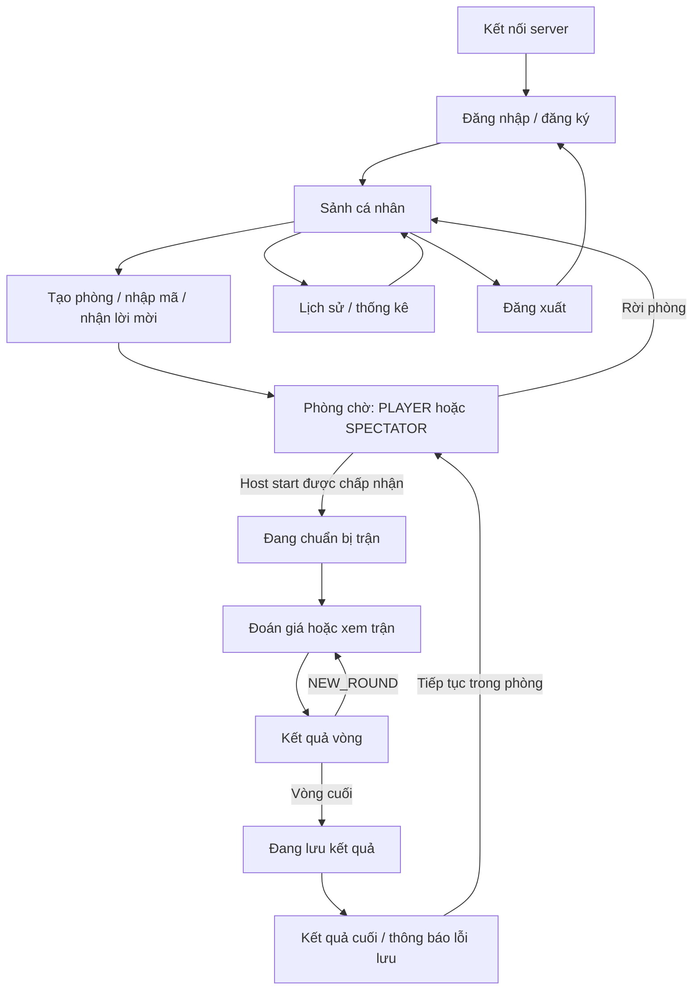

# Pipeline UI — Giai đoạn 6: GTK4

Sau khi chia package, đường dẫn source/API thực tế nằm trong [CODE_STRUCTURE.md](CODE_STRUCTURE.md). Các đoạn code minh họa bên dưới mô tả thiết kế trước khi tách module; dùng bản đồ package để tìm file hiện tại.

Ngày lập: 18/11/2026. Dự án cá nhân, triển khai tuần tự theo mốc nghiệm thu thay vì chia việc cho nhóm. Đây là kế hoạch; các màn hình và target GUI bên dưới chưa được triển khai. Nền tảng hiện tại đã hoàn thành giai đoạn 1–5 qua CLI, xem [trạng thái giai đoạn 5](phase_5_status.md).

## 1. Phạm vi và quyết định thiết kế

Đích bàn giao: mở ứng dụng desktop, đăng nhập, tạo/vào phòng, chơi 2–4 người đủ 5 vòng, người thứ 5 xem với vai trò khán giả, xem kết quả/lịch sử/thống kê và mời người online. Mọi thao tác chính thực hiện bằng nút và bàn phím, không cần nhập lệnh CLI.

Giữ luật đã có: 3 vòng SINGLE ×20 giây, 2 vòng BASKET ×30 giây, nghỉ 5 giây giữa vòng; được sửa giá đến deadline và lấy lần hợp lệ cuối. Những ý tưởng tăng độ khó vừa thảo luận chưa chốt triển khai, không được tự đưa vào UI hoặc thay luật server.

| Hạng mục | Phương án cho bản đầu |
|---|---|
| Công nghệ | C + GTK4, GtkBuilder .ui, CSS; tái sử dụng client core và codec hiện có |
| Bố cục | Một cửa sổ chính, GtkStack chuyển trang; thông báo/lời mời hiển thị trong ứng dụng |
| Ngôn ngữ | Tiếng Việt, giá hiển thị theo VND |
| Kích thước | Mặc định khoảng 1100×760; mục tiêu dùng được từ 900×640, có cuộn khi thiếu chỗ |
| Phong cách đề xuất | Nền sáng, thẻ sản phẩm rõ, xanh ngọc cho hành động chính, cam cho countdown sắp hết |
| Điều hướng | Theo trạng thái session/phòng/trận; màn chơi không có nút điều hướng tùy ý sang lobby |
| Phản hồi | Lỗi cạnh trường nhập; loading ở vùng đang tải; thông báo không che ô nhập giá |
| Phím tắt | Enter gửi form/giá, Tab di chuyển focus; focus hiển thị rõ |
| Dữ liệu | Chỉ giao tiếp TCP với server; GUI không kết nối trực tiếp PostgreSQL |

GTK yêu cầu phần lớn widget được thao tác trên main thread. Đề xuất gắn socket nonblocking vào GLib main loop để UI và network cùng có một luồng sở hữu state. Tham chiếu: [GTK threading](https://docs.gtk.org/gtk4/section-threading.html), [GLib GSource](https://docs.gtk.org/glib/struct.Source.html). GtkStack phù hợp để giữ một trang chính được hiển thị mỗi thời điểm: [tài liệu GtkStack](https://docs.gtk.org/gtk4/class.Stack.html).

## 2. Luồng người dùng



Nhánh đặc biệt: ABORTED có thể xuất hiện ngay lúc chuẩn bị hoặc giữa vòng, sau bước lưu. Người join phòng IN_GAME đi từ JOIN response đến GAME_SNAPSHOT, vào ngay trạng thái đang chơi/đã reveal/đang chờ lưu tương ứng. Không đợi GAME_STARTED vì event đó có thể đã xảy ra.

## 3. Danh sách màn hình và trạng thái

| Trang / vùng UI | Thành phần cần có | Trạng thái và hành vi |
|---|---|---|
| Kết nối | IPv4, port, nút Kết nối, thông báo lỗi | Idle/connecting/connected/failed; mặc định 127.0.0.1:6666, không treo UI khi server tắt |
| Đăng nhập | Username, password ẩn, hiện/ẩn password, Đăng nhập, sang Đăng ký | Pending khóa submit trùng; báo AUTH_FAILED/ALREADY_ONLINE; không log password |
| Đăng ký | Username, password, xác nhận password | Validation tại UI; REGISTER thành công chuyển về đăng nhập, không coi là đã login |
| Sảnh | Tên tài khoản, Tạo phòng, Nhập mã, Lịch sử, Thống kê, Người online, Đăng xuất | Không hiện danh sách phòng công khai vì chưa có API; mã phòng đúng 6 ký tự |
| Phòng chờ | Mã phòng + Sao chép, 4 vị trí PLAYER, host badge, ready, số khán giả, Rời phòng, Mời | Chỉ PLAYER có Ready; chỉ host có Bắt đầu; giải thích thiếu người/chưa ready |
| Gameplay | Vòng 1/5, loại vòng, thẻ sản phẩm, số lượng, countdown, giá nhập, giá đã nhận, tổng điểm công khai | PLAYER có form; SPECTATOR có nhãn Đang xem và không có form gửi giá |
| Kết quả vòng | Giá thật tổng, giá từng người đã gửi hoặc Chưa đoán, điểm vòng và tổng điểm | Chỉ hiện từ ROUND_RESULT hoặc snapshot đã reveal; không tự suy diễn điểm |
| Kết quả cuối | Xếp hạng, tổng điểm, FINISHED/ABORTED, trạng thái lưu, Về phòng | Không gọi thắng/thua cho ABORTED; giữ bảng cho người dùng đọc dù ROOM_UPDATE về WAITING đã tới |
| Lịch sử | Danh sách thời điểm, trạng thái trận, điểm, hạng; Xem thêm/Làm mới | Loading/empty/error/end; cursor từ server, không tự tính bằng match_id |
| Thống kê | Số trận FINISHED, lần hạng nhất, tỷ lệ thắng, điểm trung bình, cao nhất | Chưa có trận hiển thị 0; ABORTED không tính vào mẫu số |
| Người online | Tên/ID, Làm mới, Xem thêm, Mời | Chỉ người online ngoài phòng; nút Mời chỉ khả dụng khi người gửi là PLAYER trong phòng |
| Lời mời | Người mời, mã phòng, hạn còn lại, Tham gia/Bỏ qua | Hết hạn khóa Tham gia; Bỏ qua chỉ bỏ thông báo local, chưa có API từ chối |
| Mất kết nối | Banner hoặc trang lỗi, kết nối lại, quay lại đăng nhập | Hủy pending UI, khóa mutation; không tự gửi lại guess/start/join |

Thông báo lỗi phải dễ hiểu, ví dụ: “Mã phòng không tồn tại”, “Tài khoản này đang đăng nhập ở nơi khác”, “Vòng đã hết giờ; giá trước đó vẫn được giữ”. Không hiển thị người chơi đã gửi giá của họ trước reveal, vì server chưa cung cấp thông tin này.

## 4. Kiến trúc client đề xuất

```text
GtkApplication / widgets
        ↓ thao tác người dùng
Controller + điều hướng + kiểm tra quyền UI
        ↓                         ↑ render
Command builders             AppState có dữ liệu sở hữu
        ↓                         ↑ decode/cập nhật
pr_connection ← GLib adapter ← response/event từ TCP
        ↓
Server hiện có
```

Tận dụng client/src/core/connection.c, client/src/core/commands.c và shared/src/*_wire.c. Không đưa widget hoặc GLib vào shared codec. Không copy logic socket từ CLI sang từng màn hình.

### 4.1. State cần giữ

| State | Nội dung |
|---|---|
| Connection | Connected/connecting/error, connection generation, pending requests |
| Session | user_id, display_name, trạng thái login; không giữ password sau xử lý |
| Room | RoomSnapshot mới nhất, revision, self_role; phân biệt không ở phòng và đang chờ |
| Match | match_id, round_no, items, phase, deadline local suy ra từ remaining_ms, điểm đã công bố |
| Guess | draft đang nhập, các request đã gửi theo ID, giá đã ACK, vòng/match của request |
| Result | Bản sao kết quả vòng và kết quả cuối; không bị xóa khi nhận ROOM_UPDATE |
| Account | Các trang history/online, cursor, stats, loading/error, epoch của lần tải |
| Invitations | Danh sách có giới hạn, deadline local, sender/code; xóa theo session |

Callback của connection hiện chỉ cho mượn payload trong thời gian callback; phải decode/copy vào state, không giữ con trỏ vào buffer mạng. Không close/reenter connection từ callback. Nếu cần logout/disconnect/chuyển kết nối, đánh dấu để xử lý sau lượt dispatch.

### 4.2. Adapter GLib

1. Tạo một GSource quản lý fd đang thuộc pr_connection; theo dõi readable và chỉ theo dõi writable khi connecting hoặc TX còn dữ liệu.
2. Từ readiness, dựng fd_set tương ứng rồi gọi pr_connection_process hiện có, giữ nguyên budget/partial read/write.
3. Chạy pr_connection_tick bằng deadline/timer để connect timeout và request timeout vẫn hoạt động dù socket im lặng. Nút gửi command phải cập nhật interest và đánh thức source khi cần flush.
4. Xử lý HUP/ERR bằng luồng cleanup thống nhất; xử lý readable còn lại trước khi kết luận đóng nếu có dữ liệu.
5. Mỗi lần đóng/reconnect phải bỏ source cũ trước khi đóng fd, tránh callback tác động lên fd được tái sử dụng. Thao tác teardown chỉ thực hiện ngoài callback parser.
6. Countdown có timer hiển thị khoảng 100 ms; tính lại từ monotonic deadline, không giảm một biến mỗi tick. Source hủy khi thoát trang/trận hoặc shutdown; không đăng ký timer trùng khi render.

Không chạy select chờ/blocking hoặc sleep trong callback GTK. Khi UI chưa có adapter, CLI vẫn là công cụ đối chiếu hành vi. Với nhiều cửa sổ test trên cùng máy, hỗ trợ nhiều process độc lập; tránh GtkApplication gom mọi lần mở vào cùng một instance làm mất các session test.

### 4.3. Quy tắc đồng bộ quan trọng

- UI dùng điều kiện để bật/tắt nút, nhưng server vẫn quyết định quyền, thời hạn và kết quả. ROOM_UPDATE là nguồn role/host/ready, không tự nâng người thứ 5 thành PLAYER.
- GAME_STARTED khởi tạo roster; NEW_ROUND reset draft/ACK của vòng trước; GAME_SNAPSHOT có thể khởi tạo trực tiếp giữa trận. Snapshot ACCEPTING không có giá thật hoặc guess của người khác.
- Giá nhập là draft; vùng “Server đã nhận” chỉ thay đổi khi ACK thành công. Không thay nội dung ô đang gõ khi timer/điểm render lại.
- ACK SUBMIT_GUESS hiện chỉ có accepted=1, không trả số tiền. GUI phải lưu context request_id → match_id/round_no/amount/thứ tự gửi để biết ACK xác nhận giá nào. Bổ sung API command có thể trả request_id/tag trong client core nếu cần, giữ CLI tương thích; không sửa wire chỉ để UI biết giá đã gửi.
- Cho phép sửa/gửi tiếp khi ACK trước chưa về; dùng pending map, không dùng một biến pending_amount duy nhất. ACK của 3000 không được hiển thị thành đã nhận 4000 nếu ACK của 4000 chưa tới. ACK lỗi không ghi đè giá hợp lệ đã nhận.
- ACK muộn của vòng trước không được thay state vòng mới. Response đọc cũng cần session/page epoch để một lần tải history cũ không ghi vào session mới.
- Khi countdown local về 0, khóa gửi và hiển thị “Chờ kết quả”; chỉ ROUND_RESULT chốt kết quả. Không chấm điểm hoặc công bố outcome bằng timer client.
- Cuối vòng 5, giữ giá/điểm đã reveal và hiển thị “Đang lưu kết quả”. GAME_OVER xác nhận đã lưu. GAME_SAVE_FAILED ghi “Chưa nhận được xác nhận lưu; kiểm tra lịch sử khi kết nối ổn định”, không vẽ thành trận lưu thành công.
- ROOM_UPDATE WAITING cập nhật model phòng sau GAME_OVER nhưng không tự đóng bảng xếp hạng. Người dùng bấm Về phòng; nếu host đã mở trận mới và GAME_STARTED/NEW_ROUND tới, UI tự chuyển vào trận mới. Áp dụng tương tự khi người khác start lúc người dùng còn ở trang phụ.
- Mất kết nối: không tự khôi phục PLAYER cũ hoặc phát lại mutation. Kết nối và đăng nhập lại, nhập mã phòng; trong IN_GAME người quay lại là SPECTATOR theo luật hiện có. Nếu lần login lại báo ALREADY_ONLINE, hiển thị để người dùng thử sau khi server dọn session cũ.

### 4.4. Đặc tả C Header cho UI State và Controller

Tách bạch giữa tầng giao diện GTK và tầng state logic. `pr_ui_state.h` định nghĩa toàn bộ dữ liệu ứng dụng không phụ thuộc vào widget GTK:

```c
/* client/include/pr_ui_state.h */
#ifndef PR_UI_STATE_H
#define PR_UI_STATE_H

#include "pr_client.h"
#include "pr_room_wire.h"
#include "pr_game_wire.h"
#include "pr_account_wire.h"
#include <stdbool.h>
#include <stdint.h>

typedef enum {
    PR_SCREEN_CONNECT = 0,
    PR_SCREEN_AUTH,
    PR_SCREEN_LOBBY,
    PR_SCREEN_ROOM,
    PR_SCREEN_GAME,
    PR_SCREEN_ROUND_RESULT,
    PR_SCREEN_FINAL_RESULT,
    PR_SCREEN_ACCOUNT
} pr_ui_screen_t;

typedef enum {
    PR_CONN_IDLE = 0,
    PR_CONN_CONNECTING,
    PR_CONN_CONNECTED,
    PR_CONN_ERROR
} pr_ui_conn_status_t;

/* Quản lý ACK nộp giá để theo dõi chính xác giá cuối cùng server chấp nhận */
typedef struct {
    uint32_t request_id;
    uint64_t match_id;
    uint8_t  round_no;
    uint64_t amount;
    double   sent_time;
    bool     active;
} pr_tracked_guess;

typedef struct {
    pr_invite_view view;
    double deadline;
    bool active;
} pr_ui_invitation;

typedef struct {
    /* 1. Mạng & Kết nối */
    pr_connection net;
    pr_ui_conn_status_t conn_status;
    char server_ip[64];
    uint16_t server_port;
    char last_error[256];
    double error_timestamp;

    /* 2. Định danh & Phiên đăng nhập */
    bool is_authenticated;
    uint64_t self_user_id;
    char self_username[96];

    /* 3. Phòng chờ */
    bool in_room;
    pr_room_view room;

    /* 4. Trận đấu & Vòng chơi */
    bool in_game;
    pr_game_view game;
    double local_deadline;
    int remaining_seconds;

    /* 5. Quản lý đoán giá (Guess Tracking) */
    char draft_guess_str[32];
    bool has_acked_guess;
    uint64_t acked_guess_amount;
    uint32_t pending_guess_request_id;
    uint64_t pending_guess_amount;
    pr_tracked_guess guess_history[16];

    /* 6. Kết quả vòng và kết quả cuối */
    bool has_round_result;
    pr_round_result_view last_round_result;
    bool has_final_result;
    pr_game_view final_game_over;
    int save_status; /* 0: pending, 1: saved_db, 2: save_failed */

    /* 7. Dữ liệu tài khoản & Xã hội */
    pr_history_view history_items[20];
    size_t history_count;
    uint64_t history_cursor;
    pr_stats_view stats;
    bool stats_loaded;

    pr_online_player online_players[20];
    size_t online_count;
    uint64_t online_cursor;
    pr_ui_invitation invitations[16];

    /* 8. Điều hướng */
    pr_ui_screen_t current_screen;
    pr_ui_screen_t previous_screen;
} pr_ui_state;

void pr_ui_state_init(pr_ui_state *s);
void pr_ui_state_reset_room(pr_ui_state *s);
void pr_ui_state_reset_game(pr_ui_state *s);
void pr_ui_state_reset_session(pr_ui_state *s);

#endif
```

Interface điều khiển ứng dụng và quản lý widget (`client/include/pr_ui.h`):

```c
/* client/include/pr_ui.h */
#ifndef PR_UI_H
#define PR_UI_H

#include <gtk/gtk.h>
#include "pr_ui_state.h"

typedef struct pr_app pr_app;

struct pr_app {
    GtkApplication *gtk_app;
    GtkWindow *window;
    GtkStack *stack;

    /* Tham chiếu trạng thái logic */
    pr_ui_state state;

    /* GLib event source adapter ID */
    guint net_source_id;
    guint tick_timer_id;
    guint countdown_timer_id;

    /* Widgets binding (GtkBuilder) */
    GtkBuilder *builder;
};

pr_app *pr_app_create(GtkApplication *gtk_app);
void pr_app_destroy(pr_app *app);
void pr_app_show_screen(pr_app *app, pr_ui_screen_t screen);
void pr_app_show_notification(pr_app *app, const char *msg, const char *level);
void pr_app_refresh_current_view(pr_app *app);

#endif
```

## 5. Các mốc triển khai theo thứ tự

Mỗi mốc kết thúc bằng một phần chạy thử được. Mức công việc tương đối: S nhỏ, M vừa, L lớn; không gán số tuần khi chưa có quỹ thời gian. Chỉ đánh dấu hoàn tất sau khi đạt cột nghiệm thu.

| Mốc | Việc thực hiện | Phụ thuộc / mức | Đầu ra và tiêu chí nghiệm thu |
|---|---|---|---|
| **UI-01: Khung ứng dụng** | Tạo entry point GTK, window/stack, CSS, .ui, trạng thái giả; chốt bố cục và màu/chữ | Nền hiện tại / M | Mở cửa sổ, resize, đổi trang bằng state giả; hoạt động khi chạy từ thư mục khác; chưa cần server |
| **UI-02: TCP vào GTK** | GSource adapter, connection banner, pending context, timeout, disconnect, teardown và nhiều process test | UI-01 / L | Kết nối/PING thật; server tắt hoặc gửi chậm không làm đơ cửa sổ; đóng/mở lại không còn callback cũ |
| **UI-03: Tài khoản + sảnh** | Forms login/register, xác nhận password, validation, trạng thái loading, logout, form mã phòng | UI-02 / M | Hai GUI đăng nhập tài khoản khác nhau; register không tự login; lỗi user trùng/sai password/online trùng đúng và form dùng được lại |
| **UI-04: Phòng chờ** | Create/join/leave, 4 vị trí, ready, host, copy code, spectator count; xử lý ROOM_UPDATE | UI-03 / L | 4 GUI là PLAYER, GUI thứ 5 là SPECTATOR; ready/start đúng quyền, host transfer và FIFO hiển thị đúng |
| **UI-05: Gameplay** | Product cards, số lượng, countdown, draft và ACK map, cập nhật giá, public score; render snapshot; dùng placeholder trước | UI-04 / L | 2–4 người chơi đủ 5 vòng; 3000→4000 lấy ACK cuối; input không mất focus; join giữa vòng và sau reveal đúng |
| **UI-06: Kết quả + lưu DB** | Result vòng, ranking cuối, ABORTED, saving, save failed; giữ result độc lập room; trở về phòng | UI-05 / M | Kết quả khớp CLI/DB, không mất bảng khi ROOM_UPDATE tới; lỗi DB không báo thành công; trận mới reset sạch |
| **UI-07: Lịch sử + thống kê** | Loading/empty/error, phân trang Xem thêm/Làm mới, định dạng thời gian/tiền/hạng; refresh sau trận | UI-03 + UI-06 / M | Chỉ thấy history tài khoản hiện tại, không trùng khi phân trang; stats loại ABORTED; logout không rò dữ liệu sang user khác |
| **UI-08: Online + lời mời** | Danh sách online có refresh/paging, nút mời từ phòng, notification có TTL, tham gia/bỏ qua | UI-04 + UI-07 / M | Mời tài khoản online ngoài phòng, xử lý target vừa offline/vào phòng; invite hết hạn không tham gia từ thông báo; người thứ 5 vào làm khán giả |
| **UI-09: Ảnh + hoàn thiện hiển thị** | Bộ ảnh theo image_key, fallback, CSS responsive, focus, bàn phím, wrap tên dài, thông báo tiếng Việt | UI-05–08 / M | Thiếu ảnh vẫn chơi được, đủ ảnh cho catalogue demo, 900×640 không che nút; không chứa dữ liệu giá bí mật trong resource |
| **UI-10: Nghiệm thu và đóng gói** | Build/test GUI trên macOS/Linux, smoke có display, kịch bản demo nhiều client, tài liệu chạy và screenshot | Tất cả / L | Người khác theo README mở GUI và chơi 4 PLAYER + khán giả, xem lịch sử sau restart; backend regression đạt |

Sau UI-04 có bản demo tài khoản/phòng. Sau UI-06 có bản chơi được trọn trận. Sau UI-10 mới coi giai đoạn 6 hoàn tất. Không hoãn networking/error handling tới bước trang trí cuối.

## 6. Bố cục các màn hình đề xuất (Wireframes)

Mỗi màn hình được đóng gói trong một page thuộc `GtkStack`. Kích thước cửa sổ mặc định 1100×760 px, hỗ trợ co giãn tối thiểu 900×640 px (tự động bật cuộn).

### 6.1. Màn hình Kết nối & Đăng nhập / Đăng ký (Auth / Connect)

```text
┌───────────────────────────────────────────────────────────────┐
│ [● Price Game Desktop]                     Trạng thái: Chưa kết nối │
├───────────────────────────────────────────────────────────────┤
│                                                               │
│                     ĐOÁN GIÁ ĐÚNG (PRICE GAME)                │
│             Thử thách định giá sản phẩm cùng bạn bè          │
│                                                               │
│  ┌─────────────────────────────────────────────────────────┐  │
│  │ 1. Cấu hình máy chủ TCP                                 │  │
│  │ IP máy chủ:  [ 127.0.0.1                  ]             │  │
│  │ Cổng (Port): [ 6666                       ] [ Kết nối ] │  │
│  │ [✓] Đã kết nối tới server 127.0.0.1:6666                │  │
│  ├─────────────────────────────────────────────────────────┤  │
│  │ 2. Đăng nhập / Đăng ký tài khoản                        │  │
│  │ [ Tab: Đăng nhập ]  [ Tab: Đăng ký tài khoản ]          │  │
│  │                                                         │  │
│  │ Tên tài khoản:                                          │  │
│  │ [ lequoctuan                                          ] │  │
│  │ Mật khẩu:                                               │  │
│  │ [ ••••••••••••                                  ] [👁]  │  │
│  │ Xác nhận mật khẩu (chỉ khi đăng ký):                    │  │
│  │ [ ••••••••••••                                  ]       │  │
│  │                                                         │  │
│  │ [            ĐĂNG NHẬP NGAY (Enter)           ]         │  │
│  │                                                         │  │
│  │ (Lỗi nếu có: Tên đăng nhập hoặc mật khẩu không chính xác)│  │
│  └─────────────────────────────────────────────────────────┘  │
│                                                               │
└───────────────────────────────────────────────────────────────┘
```

### 6.2. Sảnh chính (Lobby)

```text
┌───────────────────────────────────────────────────────────────┐
│ Người chơi: lequoctuan (ID: 101)  | Đã kết nối | [ Đăng xuất ] │
├───────────────────────────────────────────────────────────────┤
│                                                               │
│   CHÀO MỪNG BẠN ĐẾN VỚI SẢNH CHỜ                              │
│                                                               │
│   ┌──────────────────────────┐   ┌─────────────────────────┐  │
│   │       TẠO PHÒNG MỚI      │   │     VÀO BẰNG MÃ PHÒNG   │  │
│   │                          │   │                         │  │
│   │ Tạo phòng mới và mời bạn │   │ Nhập mã phòng 6 ký tự:  │  │
│   │ bè hoặc người online.    │   │ [ ABC123              ] │  │
│   │                          │   │                         │  │
│   │ [ + Tạo phòng ngay ]     │   │ [  Vào phòng (Enter)  ] │  │
│   └──────────────────────────┘   └─────────────────────────┘  │
│                                                               │
│   TÍNH NĂNG CÁ NHÂN & CỘNG ĐỒNG                               │
│   [ 📜 Lịch sử đấu ]   [ 📊 Thống kê ]   [ 👥 Người online (3) ]│
│                                                               │
│   🔔 Lời mời gần đây:                                         │
│   - Người chơi 'minhduc' mời bạn vào phòng [XYZ789] (còn 45s) │
│     [ Chấp nhận ]  [ Bỏ qua ]                                 │
└───────────────────────────────────────────────────────────────┘
```

### 6.3. Phòng chờ (Waiting Room)

```text
┌───────────────────────────────────────────────────────────────┐
│ Mã phòng: [ ABC123 ] [📋 Sao chép] | 3/4 PLAYER | 1 Khán giả   │
├───────────────────────────────────────────────────────────────┤
│                                                               │
│ DANH SÁCH NGƯỜI CHƠI (Tối đa 4 người thi đấu chính thức)       │
│ ┌──────────────────────────────────────────────────────────┐  │
│ │ Vị trí 1: lequoctuan (Bạn - HOST)       [✓ SẴN SÀNG]      │  │
│ │ Vị trí 2: minhduc                       [✓ SẴN SÀNG]      │  │
│ │ Vị trí 3: hoangnam                      [⏳ CHƯA SẴN SÀNG] │  │
│ │ Vị trí 4: (Chỗ trống - Đang chờ người chơi gia nhập...)   │  │
│ └──────────────────────────────────────────────────────────┘  │
│                                                               │
│ KHÁN GIẢ (Tối đa 12 người xem):                               │
│ - user_bot01                                                  │
│                                                               │
│ THAO TÁC:                                                     │
│ [ Sẵn sàng / Hủy sẵn sàng ]       [ BẮT ĐẦU TRẬN (Chỉ Host) ] │
│                                                               │
│ [ 👥 Mời người online ]            [ 🚪 Rời phòng ]           │
│ (Thông báo: Đang chờ hoangnam sẵn sàng để host bắt đầu trận)  │
└───────────────────────────────────────────────────────────────┘
```

### 6.4. Màn chơi (Gameplay - SINGLE & BASKET)

```text
┌───────────────────────────────────────────────────────────────┐
│ Phòng ABC123 | Vòng 4/5 · Giỏ hàng | Còn 00:23 | Đang kết nối │
├──────────────────────────────────────────┬────────────────────┤
│                                          │ Bảng điểm trực tiếp│
│   ┌────────────────┐ ┌────────────────┐  │ Tên       Tổng điểm│
│   │   [Ảnh SP 1]   │ │   [Ảnh SP 2]   │  │ lequoctuan(Bạn) 850│
│   │ Nước giải khát │ │ Bánh quy bơ    │  │ minhduc         790│
│   │ Quy cách: Lon  │ │ Quy cách: Hộp  │  │ hoangnam        710│
│   │ Số lượng: 2    │ │ Số lượng: 1    │  │ user_bot01      650│
│   └────────────────┘ └────────────────┘  │                    │
│                                          │ Khán giả xem: 1    │
│   Bạn đoán tổng giá trị giỏ hàng:        │                    │
│   [ 450000                 ] VND         │ Trạng thái vòng:   │
│   [        GỬI DỰ ĐOÁN (Enter)       ]   │ Đang mở nhận giá   │
│                                          │                    │
│   Server đã nhận giá: 400.000 ₫          │ Quy tắc tính:      │
│   Đang cập nhật gửi:  450.000 ₫...       │ Sai số thấp điểm   │
│   (Bạn có thể sửa giá cho đến 00:00)     │ càng cao.          │
├──────────────────────────────────────────┴────────────────────┤
│ * Lưu ý: Với SPECTATOR, toàn bộ ô nhập giá chuyển thành:      │
│   "Bạn đang theo dõi trận đấu với tư cách Khán giả".          │
└───────────────────────────────────────────────────────────────┘
```

### 6.5. Kết quả vòng & Kết quả chung cuộc (Results)

```text
┌───────────────────────────────────────────────────────────────┐
│ KẾT QUẢ VÒNG 4 (Hoặc: TỔNG KẾT TRẬN ĐẤU - 5 VÒNG HOÀN TẤT)   │
├───────────────────────────────────────────────────────────────┤
│                                                               │
│  GIÁ THẬT CHÍNH XÁC: 425.000 ₫                                │
│                                                               │
│  BẢNG THÀNH TÍCH VÒNG NÀY:                                    │
│  ┌─────────────────────────────────────────────────────────┐  │
│  │ Hạng │ Người chơi   │ Giá đoán    │ Điểm vòng │ Tổng điểm│  │
│  ├──────┼──────────────┼─────────────┼───────────┼──────────┤  │
│  │  🥇  │ lequoctuan   │ 400.000 ₫   │   941     │   1791   │  │
│  │  🥈  │ minhduc      │ 450.000 ₫   │   941     │   1731   │  │
│  │  🥉  │ hoangnam     │ 350.000 ₫   │   824     │   1534   │  │
│  │  4   │ user_bot01   │ Chưa đoán   │     0     │    650   │  │
│  └─────────────────────────────────────────────────────────┘  │
│                                                               │
│  Trạng thái lưu: [✓ Đã lưu kết quả an toàn vào PostgreSQL]    │
│  (Sau vòng 1-4: Tự động chuyển sang vòng tiếp theo sau 5 giây)│
│  (Sau vòng 5: Hiện nút [ Về phòng chờ ] để giữ phòng chơi tiếp)│
└───────────────────────────────────────────────────────────────┘
```

### 6.6. Lịch sử, Thống kê & Danh sách Online / Lời mời

```text
┌───────────────────────────────────────────────────────────────┐
│ TÀI KHOẢN & LỊCH SỬ ĐẤU: lequoctuan                           │
├───────────────────────────────────────────────────────────────┤
│ [ Tab: Lịch sử trận ]   [ Tab: Thống kê ]   [ Tab: Online ]   │
│                                                               │
│ DANH SÁCH TRẬN GẦN ĐÂY:                                       │
│ ┌──────────────────────────────────────────────────────────┐  │
│ │ Mã trận #1042 │ 18/11 15:30 │ FINISHED │ Hạng 1/4 │ 4250 đ │  │
│ │ Mã trận #1038 │ 18/11 14:15 │ FINISHED │ Hạng 2/3 │ 3810 đ │  │
│ │ Mã trận #1021 │ 18/11 11:00 │ ABORTED  │ -        │ 1200 đ │  │
│ └──────────────────────────────────────────────────────────┘  │
│ [ < Trang trước ]   Trang 1   [ Xem thêm > ]   [ Làm mới 🔄 ] │
│                                                               │
│ THỐNG KÊ CHI TIẾT:                                            │
│ - Tổng trận hoàn thành: 12        - Số lần hạng nhất: 5       │
│ - Tỷ lệ thắng: 41.67%             - Điểm trung bình: 3,650    │
│ - Điểm kỷ lục: 4,720                                          │
│                                                               │
│ [ Đóng ]                                                      │
└───────────────────────────────────────────────────────────────┘
```

## 7. File, Build và Design System dự kiến

### 7.1. Cấu trúc thư mục nguồn

```text
client/
  include/pr_client.h              # core mạng TCP hiện có
  include/pr_ui.h                  # app controller lifecycle & widget hooks
  include/pr_ui_state.h            # data state độc lập widget GTK
  src/connection.c                 # giữ nguyên TCP client core
  src/commands.c                   # giữ nguyên builders
  src/gui/main.c                   # main entry, cấu hình GtkApplication
  src/gui/app.c                    # cửa sổ, GtkStack, view controllers
  src/gui/net_source.c             # GLib GSource adapter tích hợp pr_connection
  src/gui/state.c                  # update state từ responses/events
  src/gui/views/                   # các controller view tương ứng từng page
  resources/pr.gresource.xml       # bundle GResource
  resources/ui/                    # các template UI .ui (GtkBuilder)
  resources/style.css              # stylesheet chính
  resources/images/                # ảnh theo image_key và placeholder
tests/
  unit/test_ui_state.c             # unit test state transitions
  integration/test_gui_smoke.py    # headless/Xvfb smoke test
```

### 7.2. Quy ước định danh Widget (GtkBuilder IDs)

Nhằm đảm bảo code C và template .ui liên kết chính xác, chuẩn hóa ID các widget:

| ID Widget | Loại Widget | Chức năng |
|---|---|---|
| `window_main` | GtkApplicationWindow | Cửa sổ ứng dụng chính 1100×760 |
| `stack_main` | GtkStack | Stack chuyển trang không giật màn hình |
| `page_connect_auth` | GtkBox | Trang kết nối server & đăng nhập / đăng ký |
| `entry_server_ip` | GtkEntry | Nhập IPv4 máy chủ |
| `entry_server_port` | GtkEntry | Nhập cổng máy chủ |
| `btn_connect` | GtkButton | Nút kết nối TCP |
| `entry_username` | GtkEntry | Nhập tên đăng nhập |
| `entry_password` | GtkPasswordEntry | Nhập mật khẩu |
| `btn_login` | GtkButton | Nút Đăng nhập |
| `btn_register` | GtkButton | Nút Đăng ký |
| `lbl_auth_error` | GtkLabel | Hiển thị thông báo lỗi auth |
| `page_lobby` | GtkBox | Trang sảnh chính |
| `btn_create_room` | GtkButton | Nút tạo phòng |
| `entry_room_code` | GtkEntry | Ô nhập mã phòng 6 ký tự |
| `btn_join_room` | GtkButton | Nút vào phòng |
| `page_room` | GtkBox | Trang phòng chờ |
| `lbl_room_code` | GtkLabel | Nhãn hiển thị mã phòng |
| `btn_copy_code` | GtkButton | Sao chép mã phòng vào clipboard |
| `btn_ready` | GtkButton | Nút bật/tắt Sẵn sàng |
| `btn_start_game` | GtkButton | Nút Bắt đầu trận (chỉ Host) |
| `btn_leave_room` | GtkButton | Nút rời phòng chờ |
| `page_game` | GtkBox | Trang thi đấu đoán giá |
| `lbl_countdown` | GtkLabel | Nhãn đếm ngược giây còn lại |
| `box_products` | GtkBox / GtkFlowBox | Vùng hiển thị thẻ sản phẩm |
| `entry_guess_price` | GtkEntry | Ô nhập số tiền đoán |
| `btn_submit_guess` | GtkButton | Nút gửi giá đoán |
| `lbl_acked_price` | GtkLabel | Nhãn hiển thị giá server đã nhận |
| `page_result` | GtkBox | Trang kết quả vòng / kết quả trận |
| `btn_return_room` | GtkButton | Nút quay về phòng chờ |
| `banner_notification`| GtkInfoBar / GtkBox | Thanh thông báo nổi đầu trang |

### 7.3. Design System & CSS Tokens

Sử dụng bảng màu hiện đại, tương phản chuẩn Accessibility (WCAG AA):

```css
/* client/resources/style.css */
:root {
  --pr-bg-base:        #0f172a; /* Slate 900 nền tối sang trọng */
  --pr-bg-surface:     #1e293b; /* Slate 800 thẻ card */
  --pr-bg-elevated:    #334155; /* Slate 700 phần tử nổi */
  --pr-primary:        #0d9488; /* Teal 600 hành động chính */
  --pr-primary-hover:  #14b8a6; /* Teal 500 hover */
  --pr-accent-orange:  #f59e0b; /* Amber 500 countdown / cảnh báo */
  --pr-accent-red:     #ef4444; /* Red 500 lỗi / xóa / rời phòng */
  --pr-text-main:      #f8fafc; /* Slate 50 chữ chính */
  --pr-text-muted:     #94a3b8; /* Slate 400 chữ phụ / ghi chú */
  --pr-border:         rgba(255, 255, 255, 0.08);
  --pr-radius-md:      10px;
  --pr-radius-lg:      16px;
}
```

- Typography: Ưu tiên font hệ thống hiện đại (`Inter`, `SF Pro Display`, `Roboto`), font chữ số đơn cách (`monospace`) cho tiền tệ và đồng hồ countdown.
- Hiệu ứng: Chuyển màu nhẹ nhàng (`transition: 0.15s ease`), bo góc mượt mà, viền mờ cao cấp.

### 7.4. Tích hợp Makefile

Thêm các biến và target vào `Makefile` chính:

```makefile
GTK4_CFLAGS = $(shell pkg-config --cflags gtk4)
GTK4_LIBS = $(shell pkg-config --libs gtk4)
GLIB_COMPILE_RESOURCES = glib-compile-resources

GUI_RESOURCES_XML = client/resources/pr.gresource.xml
GUI_RESOURCES_C = $(BUILD)/pr_resources.c
GUI_SRC = client/src/gui/main.c client/src/gui/app.c client/src/gui/network/net_source.c client/src/gui/model/state.c
GUI_ALL = $(GUI_SRC) $(GUI_RESOURCES_C) $(CLIENT) $(SHARED)

$(GUI_RESOURCES_C): $(GUI_RESOURCES_XML)
	$(GLIB_COMPILE_RESOURCES) --target=$@ --generate-source --sourcedir=client/resources $<

gui: $(BUILD)/pr_gui

$(BUILD)/pr_gui: $(GUI_ALL) | $(BUILD)
	$(CC) $(CPPFLAGS) -Iclient/include $(CFLAGS) $(GTK4_CFLAGS) $^ $(LDFLAGS) $(GTK4_LIBS) -lm -o $@

run-gui: gui
	./$(BUILD)/pr_gui
```

## 8. Pipeline ảnh và dữ liệu sản phẩm

1. Liệt kê image_key thực tế trong seed/catalogue rồi lập bảng ánh xạ key → resource path. Không đổi tùy tiện key của dữ liệu dev đã seed.
2. Dùng ảnh tự tạo hoặc có quyền sử dụng; đồng bộ kích thước/tỷ lệ. Thử khoảng 6 ảnh đại diện trước, sau đó phủ đủ 30 sản phẩm demo.
3. Thiếu/sai key dùng placeholder, vẫn hiện tên/quy cách/số lượng; không dừng trận vì lỗi ảnh. Giữ nguyên tỷ lệ ảnh, không kéo méo.
4. Không đóng gói price, đáp án, dump DB hoặc ảnh nhãn giá vào client. Server chỉ gửi dữ liệu công khai theo protocol hiện có; không thêm query catalogue giá cho GUI.
5. Giới hạn kích thước ảnh, cache texture phù hợp. Nếu việc decode ảnh làm chậm main loop thì dùng async/worker cho phần tải, đưa kết quả về main thread theo hướng dẫn GTK.

## 9. Ma trận nghiệm thu UI

| Nhóm | Kịch bản bắt buộc | Kết quả cần đạt |
|---|---|---|
| Startup | Server chưa bật, IP/port sai, connect timeout, đóng cửa sổ đang connect | Có lỗi dễ hiểu, cửa sổ vẫn phản hồi, nguồn/timer/fd được dọn |
| Auth | User trùng, password sai, login trùng, submit hai lần, logout/login user khác | Session chính xác, không gửi trùng ngoài ý muốn, không còn dữ liệu người cũ |
| Room | 2 rồi 4 PLAYER, người thứ 5; host rời; PLAYER rời ở WAITING | Role/host/ready đúng ROOM_UPDATE; FIFO thể hiện đúng |
| Start | Thiếu người/chưa ready, host/non-host, catalogue chuẩn bị lỗi | Nút và thông báo đúng; không ở trạng thái loading vô hạn |
| Guess | 0, số lớn, âm, chữ, tràn; 3000→4000 gửi nhanh; gửi sát hạn | ACK gắn đúng amount/vòng; invalid/late không xóa giá đã nhận |
| Input | Countdown và event cập nhật khi đang gõ; Tab/Enter; tên sản phẩm dài | Không mất ký tự/focus, entry không bị dựng lại, layout không tràn |
| Spectator | Join lúc ACCEPTING/REVEALED/chờ lưu; join lại sau disconnect | Snapshot dựng đúng view, không có thao tác guess/ready/start dành PLAYER |
| Results | Round reveal, đủ 5 vòng, đồng hạng, ABORTED | Điểm/rank từ server; bảng cuối không bị ROOM_UPDATE xóa |
| Persistence | DB chậm/lỗi/khôi phục; restart sau commit | Không báo lưu thành công sớm; lỗi rõ, history phản ánh dữ liệu đã commit |
| Invitations | Hết hạn, trùng, offline, target vừa vào phòng, đủ 4 người | Không kẹt loading, luật JOIN/SPECTATOR được giữ |
| Account | History rỗng/nhiều trang/làm mới; stats sau trận; logout khi đang tải | Không trùng/sai trang hoặc rò state giữa session |
| Assets | Thiếu ảnh, tên có tiếng Việt, chạy từ cwd khác | Placeholder, UTF-8 hiển thị đúng, resource vẫn nạp được |
| Lifecycle | Đóng/mở nhiều lần, mất mạng, nhiều GUI cùng máy, event khi xem trang phụ | Không callback lên widget đã hủy, không gửi lại mutation; trận mới vẫn điều hướng đúng |

Kiểm thử theo tầng: unit cho state/ACK mapping/permissions có nhiều nhánh; fake-server cho event order và response chậm; smoke GtkBuilder/resources dưới display; test thủ công cho focus/resize và trải nghiệm nhiều cửa sổ. Khi sửa core dùng chung, chạy lại unit/client và các integration bị ảnh hưởng; trước nghiệm thu cuối chạy toàn bộ backend regression. Không cần test từng thuộc tính CSS.

## 10. Kế hoạch triển khai & Theo dõi tiến độ

Checklist các mốc công việc triển khai tuần tự:

- [x] **UI-01: Khung ứng dụng GTK4 & Mock Views**: Tạo entry point GTK, window/stack, CSS, trạng thái giả, chuyển trang mượt mà; tích hợp `make gui` & `make run-gui`. (Đã hoàn thành)
- [x] **UI-02: GLib Adapter & TCP Network**: Adapter GSource cho `pr_connection`, banner trạng thái, pending timeouts, disconnect/reconnect sạch. (Đã hoàn thành)
- [x] **UI-03: Tài khoản & Sảnh (Auth + Lobby)**: Form login/register, validate client-side, mã lỗi tiếng Việt, tạo/vào phòng. (Đã hoàn thành)
- [x] **UI-04: Phòng chờ (Room Waiting)**: Roster 4 PLAYER + SPECTATOR, nút Ready, nút Bắt đầu cho Host, copy mã phòng, FIFO slots. (Đã hoàn thành)
- [x] **UI-05: Gameplay (SINGLE & BASKET)**: Render sản phẩm, đồng hồ countdown thời gian thực, nộp giá draft & tracking ACK giá mới nhất, scoreboard trực tiếp. (Đã hoàn thành)
- [x] **UI-06: Kết quả vòng & Kết quả chung cuộc**: Reveal giá thật, hiển thị xếp hạng và điểm số, xử lý trạng thái lưu DB PostgreSQL (Game Over / Save Failed). (Đã hoàn thành)
- [x] **UI-07: Lịch sử & Thống kê cá nhân**: Modal/trang xem lịch sử đấu phân trang, thống kê số trận/tỷ lệ thắng/điểm cao nhất. (Đã hoàn thành)
- [x] **UI-08: Danh sách Online & Lời mời**: Paging người chơi online ngoài phòng, popup mời thi đấu có thời hạn đếm ngược (TTL 60s). (Đã hoàn thành)
- [x] **UI-09: Hoàn thiện Assets & Giao diện**: GResource nạp bộ ảnh catalogue, ảnh placeholder fallback, hoàn thiện phím tắt và CSS dark mode. (Đã hoàn thành)
- [x] **UI-10: Nghiệm thu toàn diện & Đóng gói**: Smoke tests, tích hợp Makefile/CI, kịch bản chạy thử nghiệm nhiều client cùng lúc. (Đã hoàn thành)

